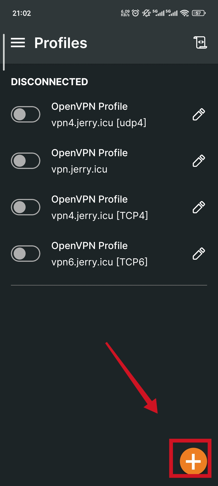
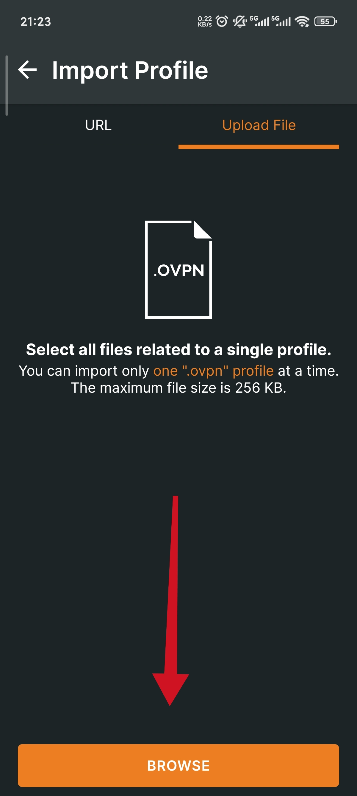
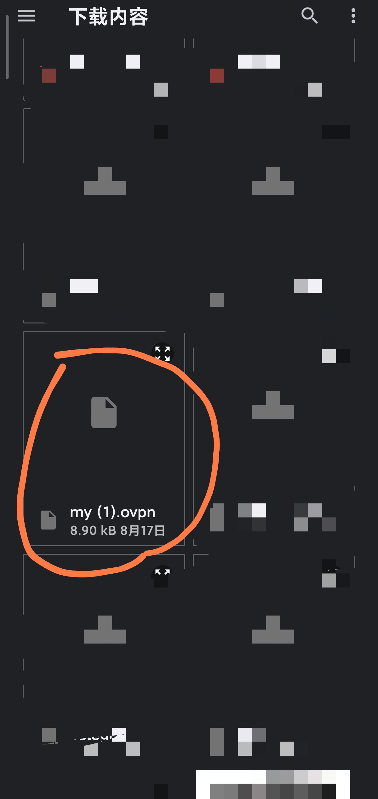
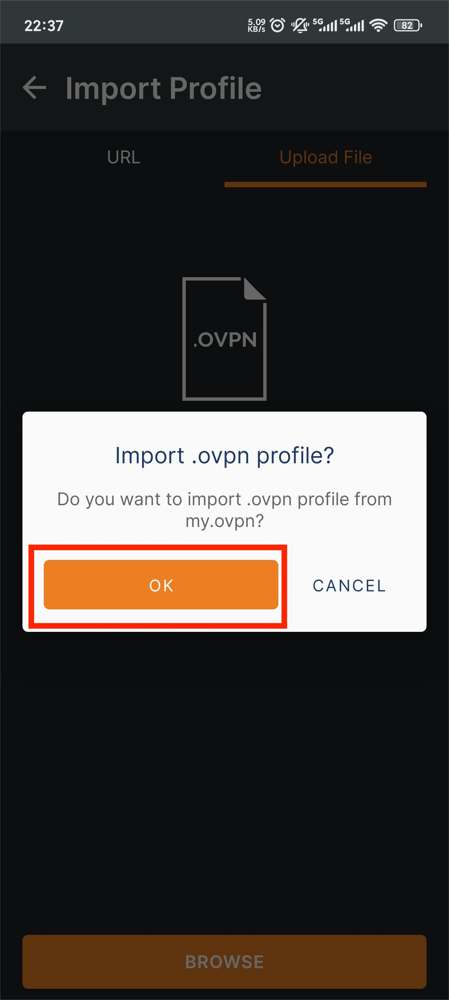
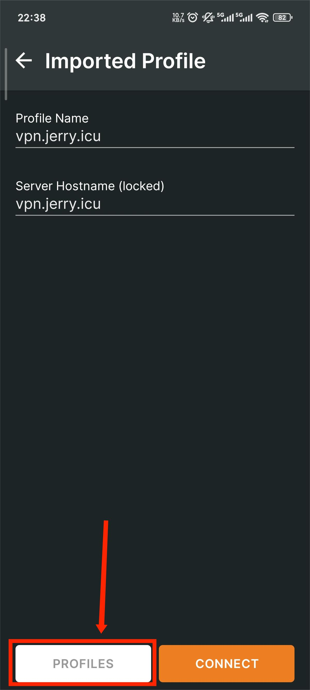
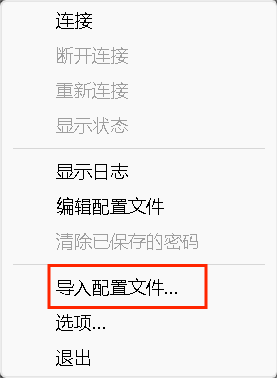

import Tabs from '@theme/Tabs';
import TabItem from '@theme/TabItem';
import Image from '@theme/IdealImage';

# 通过已有配置文件建立连接  

:::info  
### 相关资源  
#### Android  
[Openvpn Connect for Android](../resources/OpenVPN_Connect_3.7.1_APKPure.xapk)  
[Openvpn for windows (amd64)](../resources/OpenVPN-2.6.14-I004-amd64.msi)  
[~~udp4.ovpn~~](#)  
:::  

<Tabs>{/*Platform*/}
  <TabItem value='mobile' label='移动端'>{/*mobile*/}
<Tabs>
  <TabItem value='android' label='非IOS'>{/*Android*/}
1.下载并安装`Openvpn Connect`  
2.准备配置文件(由服务器生成)  
3.导入配置文件  

4.连接vpn
  </TabItem>{/*Android end*/}

  <TabItem value='ios' label='IOS'>{/*ios*/}
  TODO
  </TabItem>{/*ios end*/}
</Tabs>
  </TabItem>{/*mobile end*/}

  <TabItem value='PC' label='PC'>{/*PC*/}
<Tabs>
  <TabItem value='windows' label='Windows'>{/*Windows*/}
1.下载并安装OpenVPN-Protable(无脑下一步), 运行它  
2.准备配置文件(由服务器生成)  
3.导入配置文件  
  
4.连接
  </TabItem>{/*Windows end*/}
  
  <TabItem value='linux' label='Linux'>{/*Linux*/}
  TODO
  </TabItem>{/*Linux end*/}
</Tabs>
  </TabItem>{/*PC end*/}

</Tabs>{/*Platform end*/}
